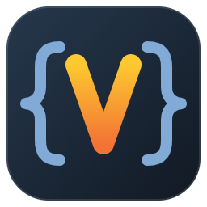

  

# Velocity Template Editor

Edit Apache Velocity templates and preview them with realistic data, without running the application they belong to.

## Features

- **Syntax highlighting** for Velocity directives, references, comments and the surrounding HTML.
- **Live preview** in your browser, rendered by Apache Velocity 2.3 and updated as you type.
- **Context Manager** in the side bar for the values templates render with:
  - variables shared by every template;
  - per-template **scenarios** (named sets of values) for testing each state of a page;
  - **template groups**, so variants of one template share their scenarios.
- **Mocks** for what a template expects from its application:
  - an HTTP request (URL parameters and headers);
  - locale and messages from `.properties` files;
  - an escape tool;
  - JavaScript implementations of the template's methods.
- **Compare** two templates from a group side by side, on the same scenario.
- **Captured links and forms**: the preview shows where a link or form would go, and what a form would send, instead of navigating.
- **Content Security Policy** applied to the preview, to match production.
- **Screenshot tests**: a PNG of every scenario of every template, using Chrome or Edge.

## Getting started

1. Install **Java 17 or newer**. The extension starts a small local Velocity server for the preview.
2. Open a `.vm`, `.vtl` or `.velocity` file. For `.html` templates, run **Velocity: Detect Velocity Syntax** once.
3. Click **Manage Context** in the editor title bar and create an environment context file.
4. Click **Open Preview**.

See [Getting started](docs/GETTING-STARTED.md) for the full walkthrough, and the [documentation](docs/README.md) for everything else.

## Commands

| Command | Does |
|---------|------|
| **Velocity: Open Preview** | Preview the current template in the browser |
| **Velocity: Manage Context (Variables & Objects)** | Open the Context Manager for the current template |
| **Velocity: Detect Velocity Syntax** | Switch an HTML file to Velocity, and optionally always for its folder |
| **Velocity: Run Screenshot Tests** | Save a screenshot of every scenario of every template |
| **Velocity: Open Developer Tools** | Inspect the Context Manager view |

## Settings

| Setting | Default | Meaning |
|---------|---------|---------|
| `velocity.preview.autoRefresh` | `true` | Re-render the preview as you type |
| `velocity.preview.refreshDelay` | `500` | Milliseconds to wait after typing before re-rendering |
| `velocity.useApacheVelocity` | `true` | Start the Java Velocity server. The preview needs it |
| `velocity.debugLogging` | `false` | Log render details to **Output › Velocity Server** and the preview's browser console |

## Requirements

- Java 17 or newer
- VS Code 1.85 or newer
- Google Chrome or Microsoft Edge, for screenshot tests only

## Privacy and security

Nothing leaves your machine.
- **Velocity server:** listens on `127.0.0.1` and requires a per-session token.
- **Preview server:** answers only to the preview itself.
- **Mock JavaScript and templates:** run sandboxed, with no access to Java classes.

## License

[MIT](LICENSE)
