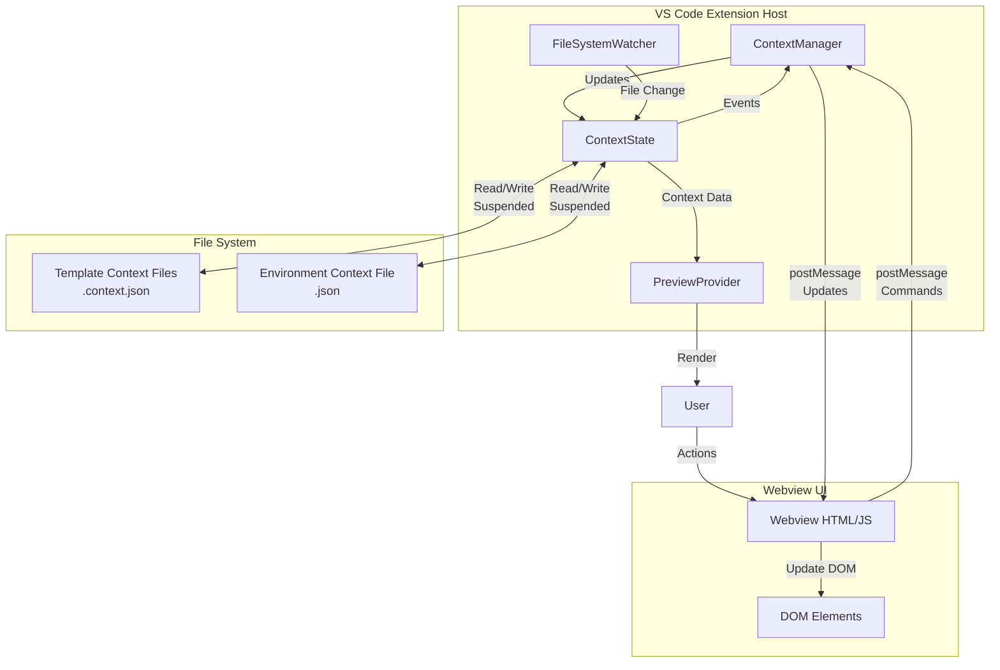
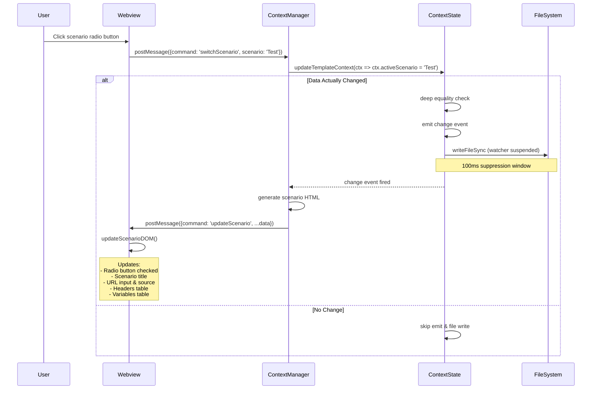
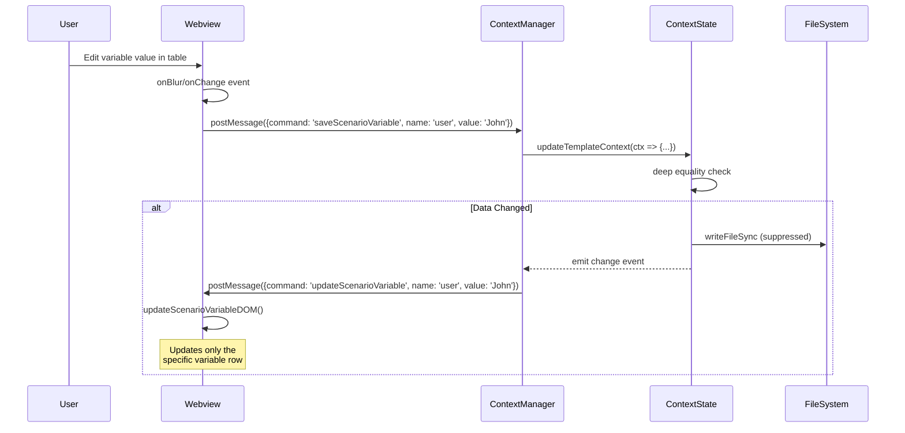
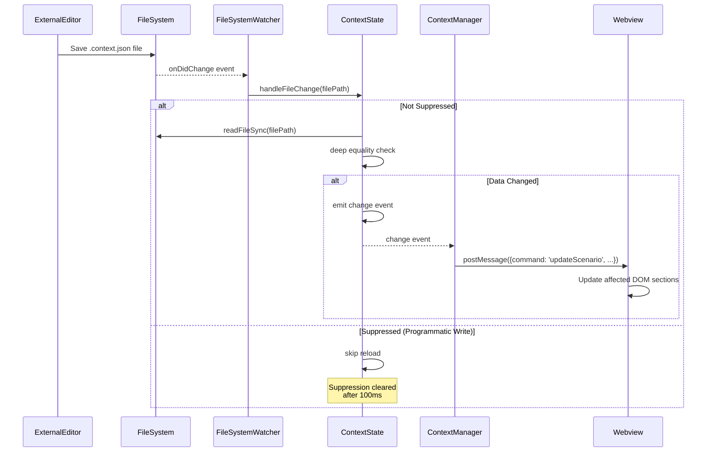
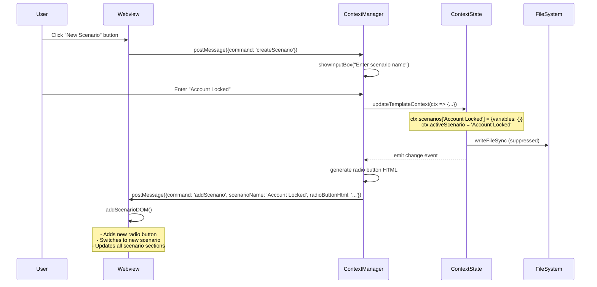

# Velocity Template Editor - Architecture Documentation

## Overview

This document describes the event-driven architecture for the Velocity Template Editor VS Code extension. The architecture eliminates full-page refreshes in favor of targeted, reactive DOM updates.

## Core Principles

1. **Single Source of Truth**: `ContextState` holds all template and environment context data in memory
2. **Event-Driven Updates**: Changes emit events that trigger targeted UI updates
3. **Change Detection**: Updates only occur when data actually changes (deep equality check)
4. **File Synchronization**: File system writes are suspended during programmatic updates to prevent recursive triggers
5. **No Full Page Refreshes**: Every operation sends specific update messages to update only affected DOM elements

## Architecture Components



## State Management Flow

### Scenario Switching



### Variable Update



### File System Change (External Edit)



### Create New Scenario



## Key Classes

### ContextState

**Purpose**: Centralized state management with change detection and event emission.

**Responsibilities**:
- Store template and environment context in memory
- Detect changes via deep equality comparison
- Emit events only when data actually changes
- Synchronize with file system (with watcher suspension)
- Provide read-only snapshots of state

**Key Methods**:
```typescript
loadTemplateContext(templatePath: string, contextPath: string): void
loadEnvironmentContext(filePath: string): void
updateTemplateContext(updater: (ctx: ContextFileData) => void, source: 'ui' | 'api'): void
updateEnvironmentContext(updater: (ctx: ContextData) => void, source: 'ui' | 'api'): void
getTemplateContext(): Readonly<ContextFileData> | null
getEnvironmentContext(): Readonly<ContextData>
getMergedContext(): ContextData
handleFileChange(filePath: string): void
```

**Event System**:
```typescript
interface ContextStateChangeEvent {
    type: 'templateContext' | 'environmentContext';
    source: 'file' | 'ui' | 'api';
    oldValue: any;
    newValue: any;
}
```

### ContextManager

**Purpose**: Mediates between VS Code extension, ContextState, and Webview UI.

**Responsibilities**:
- Handle webview commands from UI
- Subscribe to ContextState change events
- Generate HTML for UI updates
- Send targeted update messages to webview
- Coordinate with PreviewProvider

**Message Flow**:
1. Receive command from webview via `postMessage`
2. Update ContextState via updater function
3. Listen for change event from ContextState
4. Generate necessary HTML
5. Send specific update message to webview

### Webview Scripts

**Purpose**: Handle DOM updates without full page reloads.

**Key Functions**:
```javascript
updateScenarioDOM(msg)           // Switch scenario
updateScenarioVariableDOM(msg)   // Update single variable
updateScenarioHeaderDOM(msg)     // Update single header
addScenarioDOM(msg)              // Add new scenario
deleteScenarioDOM(msg)           // Remove scenario
renameScenarioDOM(msg)           // Rename scenario
updateUrlDOM(msg)                // Update URL field
```

**Update Strategy**:
- Find specific DOM element by ID or data attribute
- Update only that element's content/attributes
- Preserve scroll position
- Maintain focus where appropriate
- No innerHTML replacement of large sections

## File System Synchronization

### Write Suppression

To prevent infinite loops when writing to files monitored by FileSystemWatcher:

1. ContextState sets `suppressFileWrite = true`
2. Writes to file system
3. Sets timeout to clear flag after 100ms
4. FileSystemWatcher checks suppression flag in `handleFileChange()`
5. If suppressed, skips reload

```typescript
private writeToFile(): void {
    this.suppressFileWrite = true;
    fs.writeFileSync(this.contextFilePath, JSON.stringify(this.templateContext, null, 2), 'utf8');
    setTimeout(() => {
        this.suppressFileWrite = false;
    }, 100);
}
```

### Cache Invalidation

- ContextManager maintains a cache for performance
- Cache is updated immediately when ContextState changes
- FileSystemWatcher clears cache on external file changes
- Lazy reload on next access

## Performance Optimizations

1. **Change Detection**: Deep equality check prevents unnecessary updates
2. **Targeted DOM Updates**: Only affected elements are updated
3. **Event Debouncing**: File system changes debounced via suppression window
4. **HTML Pre-generation**: HTML generated once in extension, sent to webview
5. **Lazy Load**: File reads deferred until needed

## Migration Strategy

The refactor from full-page refreshes to targeted updates is done incrementally:

1. ✅ Create ContextState class with event system
2. ✅ Define message types for all operations
3. ✅ Create DOM update functions in webview
4. 🔄 Refactor high-frequency operations (scenario switching, variable edits)
5. 🔄 Refactor medium-frequency operations (headers, URLs)
6. 🔄 Refactor low-frequency operations (create/delete scenarios)
7. 🔄 Replace all `updateWebview()` calls with specific messages
8. ✅ Document architecture and create sequence diagrams

## Testing Strategy

### Unit Tests
- ContextState change detection
- Deep equality comparisons
- Event emission logic

### Integration Tests
- ContextManager → ContextState interaction
- File system watcher behavior
- Message passing between extension and webview

### Manual Testing
1. Switch scenarios → verify no scroll, data updates
2. Edit variables → verify only that row updates
3. Create scenario → verify radio button added correctly
4. External file edit → verify UI reflects changes
5. Rapid successive edits → verify no duplicate updates

## Benefits of New Architecture

1. **No Scroll Jumps**: Targeted updates preserve scroll position
2. **Better Performance**: Only affected DOM elements are updated
3. **Clearer Code**: Explicit message types instead of monolithic refresh
4. **Easier Debugging**: Each operation has specific message flow
5. **Maintainable**: Changes isolated to specific update handlers
6. **Extensible**: New features add new message types, not complexity to existing code
